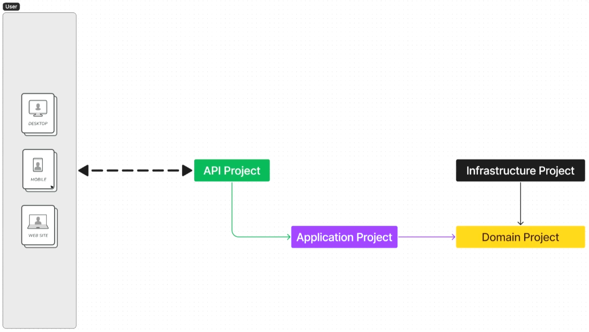
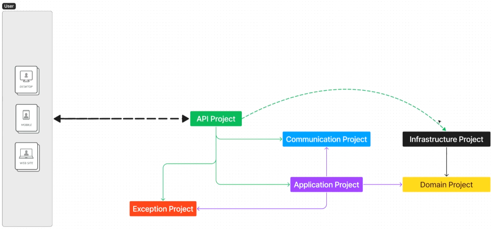

# <p align="center"> MyRecipeBook </p>

<p align="center">
  <strong>Catálogo e Gerenciador de Receitas desenvolvido com as melhores práticas de Clean Architecture e .NET moderno.</strong>
</p>

<p align="center">
  
  
  
  
  
</p>

---

##  Sumário

- [Visão Geral](#-visão-geral)
- [Objetivos do Projeto](#-objetivos-do-projeto)
- [Plano Arquitetural](#-plano-arquitetural)
  - [Arquitetura Inicial](#1-arquitetura-inicial)
  - [Arquitetura Melhorada Final](#2-arquitetura-melhorada-final)
- [Detalhamento das Camadas](#-detalhamento-das-camadas)
- [Tecnologias e Ferramentas](#-tecnologias-e-ferramentas)
- [Estrutura da Solução](#-estrutura-da-solução)
- [Como Executar o Projeto](#-como-executar-o-projeto)
- [Contexto Educacional](#-contexto-educacional)
- [Licença](#-licença)

---

##  Visão Geral

O **MyRecipeBook** é uma aplicação completa para gerenciamento e catálogo de receitas culinárias desenvolvida em **.NET 10**. O foco primordial do projeto é a aplicação prática de padrões arquiteturais corporativos, com ênfase em:

- **Clean Architecture & DDD**: Separação rigorosa de responsabilidades e desacoplamento do domínio em relação a frameworks e banco de dados.
- **Manutenibilidade e Escalabilidade**: Estrutura modular pensada para facilitar a inclusão de novas features e regras de negócio.
- **Segurança e Padronização**: Contratos de comunicação bem definidos e tratamento de exceções global e resiliente.
- **Preparado para o Mercado**: Segue padrões reais exigidos em equipes de engenharia de software de alta performance.

---

##  Objetivos do Projeto

-  **Isolamento de Responsabilidades:** Cada projeto tem um propósito único e limites claros.
-  **Contratos Estáveis:** DTOs e ViewModels isolados na camada de comunicação, protegendo o modelo de domínio de exposições indevidas.
-  **Tratamento de Exceções Padronizado:** Camada dedicada para gerenciar erros conhecidos e inesperados de forma elegante.
-  **Persistência Desacoplada:** Acesso a dados via repositórios na camada de infraestrutura, com inversão de dependência (DIP).

---

##  Plano Arquitetural

A arquitetura do projeto foi planejada em duas etapas evolutivas:

### 1. Arquitetura Inicial

Na fase inicial, a solução foi modelada no padrão clássico de 4 camadas:

<p align="center">
  
</p>

#### Camadas da Arquitetura Inicial:
-  **API Project (`MyRecipeBook.Api`)**: Ponto de entrada, controladores REST e injeção de dependências.
-  **Application Project (`MyRecipeBook.Application`)**: Casos de uso, orquestração e regras de serviço.
-  **Domain Project (`MyRecipeBook.Domain`)**: Entidades, contratos/interfaces e regras de negócio essenciais.
-  **Infrastructure Project (`MyRecipeBook.Infrastructure`)**: Implementação de repositórios, persistência de dados e serviços externos.

---

### 2. Arquitetura Melhorada Final

Para suportar um ecossistema mais robusto e desacoplado, foram introduzidas duas camadas especializadas: **Exception** e **Communication**.

<p align="center">
  
</p>

#### Evolução e Benefícios:
1. **`MyRecipeBook.Communication`**: Desacopla as requisições (Requests) e respostas (Responses) da API, permitindo que clientes (web, mobile) consumam contratos padronizados sem acoplamento à lógica de aplicação.
2. **`MyRecipeBook.Exception`**: Centraliza a taxonomia de erros, filtros de exceção e mensagens customizadas, evitando repetição de código e mantendo as respostas HTTP consistentes.

---

##  Detalhamento das Camadas

A tabela a seguir resume as camadas da solução final e seus papéis:

| Ícone | Camada / Projeto | Responsabilidade Principal | Dependências Permitidas |
| :---: | :--- | :--- | :--- |
|  | **`MyRecipeBook.Api`** | Ponto de entrada HTTP, Swagger/OpenAPI, Middlewares e configuração de DI. | `Application`, `Communication`, `Exception` |
|  | **`MyRecipeBook.Communication`** | Contratos de troca de dados (DTOs, Requests, Responses). | *Nenhuma* (Independente) |
|  | **`MyRecipeBook.Exception`** | Exceções de negócio, códigos de erro e catálogo de mensagens. | *Nenhuma* (Independente) |
|  | **`MyRecipeBook.Application`** | Casos de uso (Use Cases), validadores e orquestração de regras. | `Domain`, `Communication`, `Exception` |
|  | **`MyRecipeBook.Domain`** | Entidades de domínio, interfaces de repositório e regras centrais. | *Nenhuma* (Núcleo) |
|  | **`MyRecipeBook.Infrastructure`** | Acesso ao banco de dados (EF Core), migrações e integrações externas. | `Domain` |

---

##  Tecnologias e Ferramentas

O projeto utiliza o estado da arte do ecossistema .NET:

-  **Framework:** [.NET 10](https://dotnet.microsoft.com/) / ASP.NET Core Web API
-  **Linguagem:** C# 13
-  **Padrão Arquitetural:** Clean Architecture & Domain-Driven Design (DDD)
-  **Persistência / ORM:** Entity Framework Core
-  **Documentação da API:** OpenAPI & Swagger UI
-  **Testes:** xUnit, Moq, FluentAssertions *(camada de testes em evolução)*

---

##  Estrutura da Solução

```text
MyRecipeBook/
├── assets/
│   ├── desenhoArquitetural.png        # Diagrama da arquitetura inicial
│   ├── desenhoArquitetural2.png       # Diagrama da arquitetura melhorada
│   └── icons/                         # Ícones visuais do projeto
│       ├── activity.svg
│       ├── architecture.svg
│       ├── backend.svg
│       ├── bot.svg
│       ├── briefcase.svg
│       ├── cloud.svg
│       ├── code.svg
│       ├── connect.svg
│       ├── database.svg
│       ├── education.svg
│       ├── explore.svg
│       ├── frontend.svg
│       ├── target.svg
│       ├── tools.svg
│       └── user.svg
├── src/
│   ├── Backend/
│   │   ├── MyRecipeBook.Api/              # Camada de apresentação e controladores
│   │   ├── MyRecipeBook.Application/      # Casos de uso e lógica de negócio
│   │   ├── MyRecipeBook.Domain/           # Entidades e interfaces
│   │   └── MyRecipeBook.Infrastructure/   # Persistência e serviços externos
│   └── Shared/
│       ├── MyRecipeBook.Communication/    # DTOs, Requests e Responses
│       └── MyRecipeBook.Exception/        # Tratamento centralizado de erros
├── tests/                             # Testes unitários e de integração
├── MyRecipeBook.slnx                  # Arquivo da solução .NET
├── LICENSE.txt                        # Licença MIT
└── README.md                          # Documentação do projeto
```

---

##  Como Executar o Projeto

### Pré-requisitos

- [.NET 10 SDK](https://dotnet.microsoft.com/download/dotnet/10.0) instalado.
- IDE recomendada: [Visual Studio 2026](https://visualstudio.microsoft.com/), [VS Code](https://code.visualstudio.com/) com a extensão C# Dev Kit, ou [JetBrains Rider](https://www.jetbrains.com/rider/).
- Git para clonar o repositório.

### Passo a Passo

1. **Clonar o repositório:**
   ```bash
   git clone https://github.com/brunoemferreira/MyRecipeBook.git
   cd MyRecipeBook
   ```

2. **Restaurar as dependências:**
   ```bash
   dotnet restore
   ```

3. **Compilar a solução:**
   ```bash
   dotnet build
   ```

4. **Executar a API:**
   ```bash
   dotnet run --project src/Backend/MyRecipeBook.Api
   ```

5. **Acessar a documentação Swagger:**
   - Abra o navegador e navegue até: `https://localhost:5001/swagger` (ou a porta configurada no terminal).

---

##  Contexto Educacional

Este repositório foi concebido como parte do curso **".NET: Um Curso Orientado para o Mercado de Trabalho"** na plataforma **Udemy**. 

O curso é direcionado à capacitação de desenvolvedores com foco nas exigências práticas do mercado:
- Arquitetura corporativa desacoplada;
- Escrever código legível, testável e manutenível;
- Boas práticas de design de software e governança de APIs.

---

##  Licença

Este projeto está distribuído sob a licença **MIT**. Consulte o arquivo [LICENSE.txt](LICENSE.txt) para mais detalhes.

---

<p align="center">
  Desenvolvido com dedicação por <strong>Bruno Ferreira</strong> 🚀
</p>
